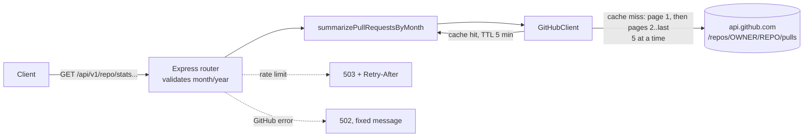

# Recurate

Recurate answers one question about a GitHub repository: how many pull requests were opened and closed each month? It pages through the repository's pull requests on the GitHub REST API, buckets them by UTC month and serves the counts from a small Express + TypeScript API. It points at [`downshift-js/downshift`](https://github.com/downshift-js/downshift) by default. Any other public repository can be configured.

The API is described in [`docs/api-spec.yaml`](docs/api-spec.yaml) and browsable through Swagger UI at `/api/v1/api-docs`.

## How it works



Every endpoint needs the full pull request list. The client caches it in memory for `CACHE_TTL_SECONDS` and shares one in-flight fetch between concurrent requests. Without that, each API call would cost GitHub a dozen or more requests.

## Running it

You need Node 22 (see `.nvmrc`), or Docker.

```bash
cp .env.example .env        # optional: add a token, change the repository
npm ci
npm run dev                 # ts-node + nodemon on http://localhost:3000
```

For a production-style build:

```bash
npm run build && npm start
```

With Docker, `.env` is optional:

```bash
docker compose up --build
curl http://localhost:3000/health
```

### Configuration

| Variable | Default | Notes |
|---|---|---|
| `GITHUB_PERSONAL_ACCESS_TOKEN` | *(empty)* | Without it GitHub allows 60 requests an hour. A fine-grained token with read-only "Pull requests" access is enough. |
| `GITHUB_OWNER` / `GITHUB_REPO` | `downshift-js` / `downshift` | Validated against GitHub's naming rules at startup. |
| `API_VERSION` | `v1` | Routes mount under `/api/<API_VERSION>`. |
| `PORT` | `3000` | |
| `CACHE_TTL_SECONDS` | `300` | `0` disables the cache. |

## Endpoints

| Route | Returns |
|---|---|
| `GET /api/v1/repo/stats` | Every month with activity, oldest first |
| `GET /api/v1/repo/stats/summary?month=9&year=2021` | One month (`month` 1-12, leading zero optional) |
| `GET /api/v1/repo/stats/year-summary?year=2021` | The months of one year |
| `GET /health` | `{"status":"ok"}`, without calling GitHub |

A pull request counts as *opened* in the month of its `created_at` and as *closed* in the month of its `closed_at`, whether or not it was merged.

### Examples

These were captured by running the built app in a container, with GitHub replaced by a stub that serves six sample pull requests. The numbers are illustrative, not Downshift's real history.

```http
GET /api/v1/repo/stats/summary?month=9&year=2021

HTTP 200
{ "period": "2021-09", "month": "September 2021", "opened": 3, "closed": 1 }
```

```http
GET /api/v1/repo/stats/year-summary?year=2021

HTTP 200
[
  { "period": "2021-09", "month": "September 2021", "opened": 3, "closed": 1 },
  { "period": "2021-10", "month": "October 2021", "opened": 1, "closed": 2 },
  { "period": "2021-11", "month": "November 2021", "opened": 1, "closed": 1 }
]
```

```http
GET /api/v1/repo/stats/summary?month=13&year=2021

HTTP 400
{ "error": "month must be 1-12 and year a four-digit year." }
```

```http
GET /api/v1/repo/stats/year-summary?year=2019

HTTP 404
{ "error": "No data found for the given year." }
```

When GitHub reports an exhausted quota (403 with `x-ratelimit-remaining: 0`, or 429), the API passes the wait time on:

```http
GET /api/v1/repo/stats

HTTP 503
Retry-After: 1200
{ "error": "GitHub rate limit reached, try again later." }
```

## Design notes

- **Not an open proxy.** The owner and repository come from configuration and are checked once at startup. They are URL-encoded into a path on the fixed origin `https://api.github.com`. Query parameters only filter the computed summary. From GitHub's `Link` header only the last page *number* is read (capped at 1000); its URLs are never followed, and redirects are refused.
- **The token stays server-side.** It is sent only in the `Authorization` header. Error responses and log lines use fixed messages and status codes, never upstream bodies, headers or network error causes.
- **UTC months.** GitHub timestamps are UTC, so a pull request opened at 23:30Z on 31 August counts towards August whatever the server's time zone.
- **Limits.** The cache lives in process memory, so each instance keeps its own copy. A cold cache on a large repository costs one request per 100 pull requests.

## Development

```bash
npm test            # Jest + supertest, no network needed
npm run lint        # ESLint with typescript-eslint
npm run typecheck   # type-checks src and tests
```

The tests never call GitHub. Router tests inject a stub pull request source, and client tests inject a fake `fetch`. Together they cover pagination, caching, rate limits, path and host pinning, and token redaction.

## License

MIT, see [LICENSE](LICENSE).
